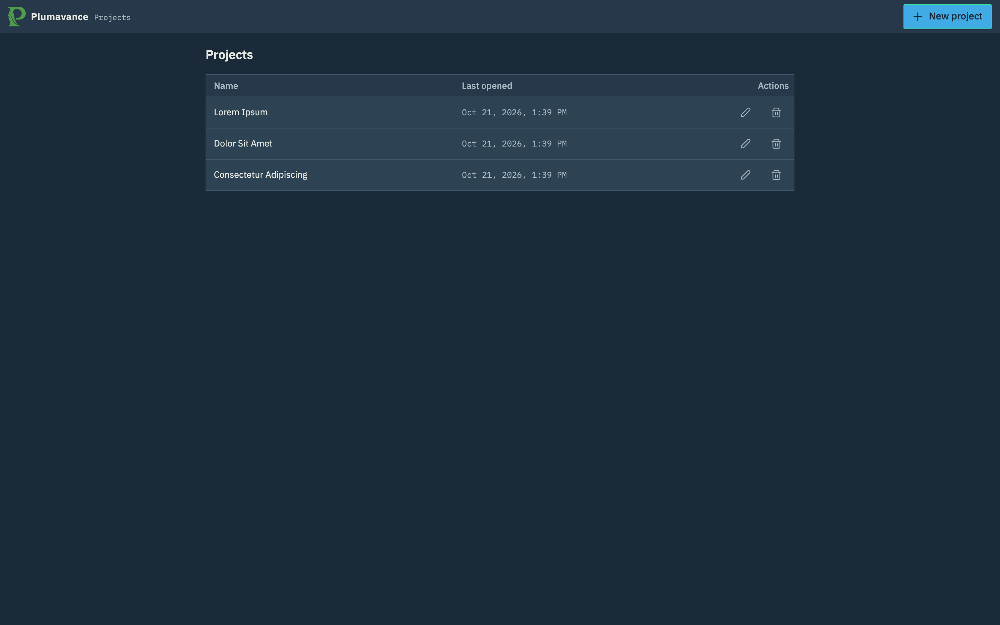
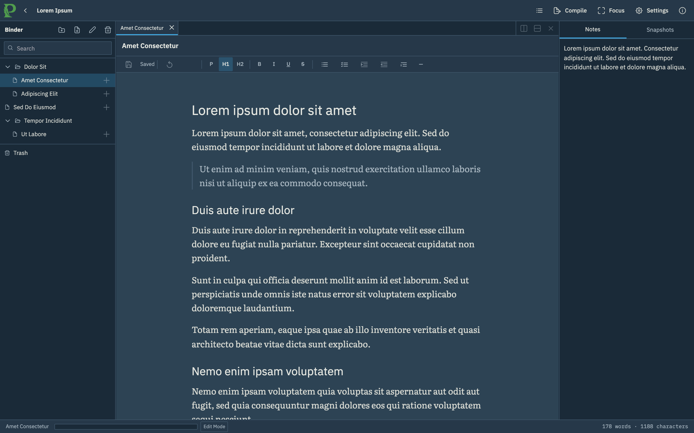
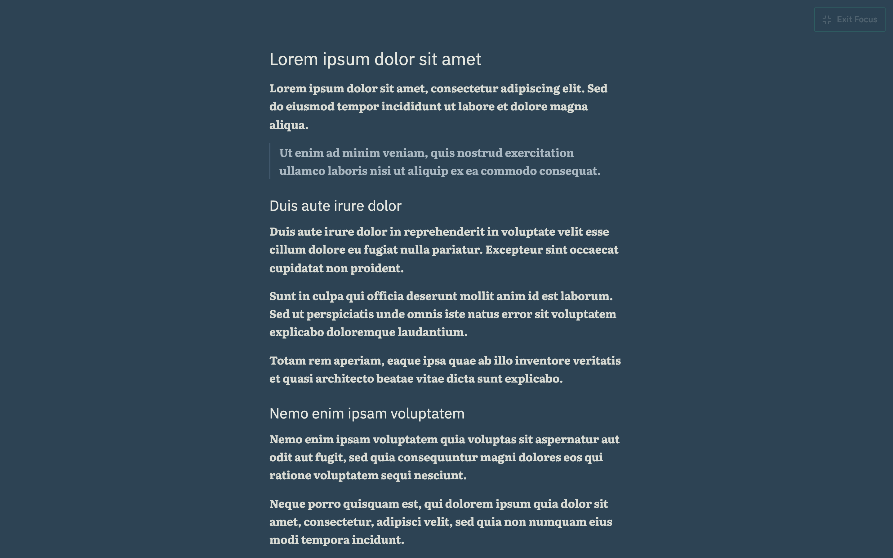
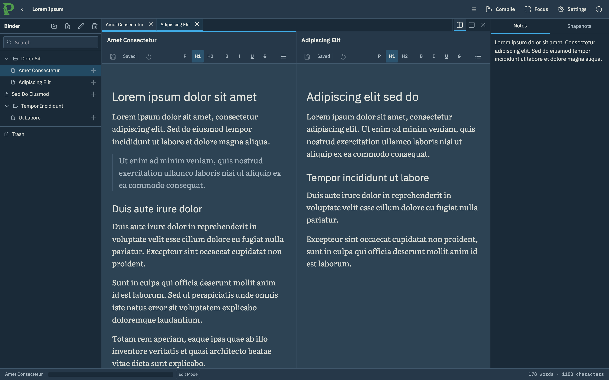
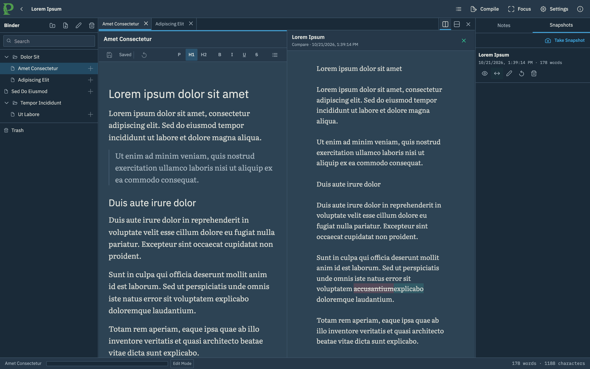
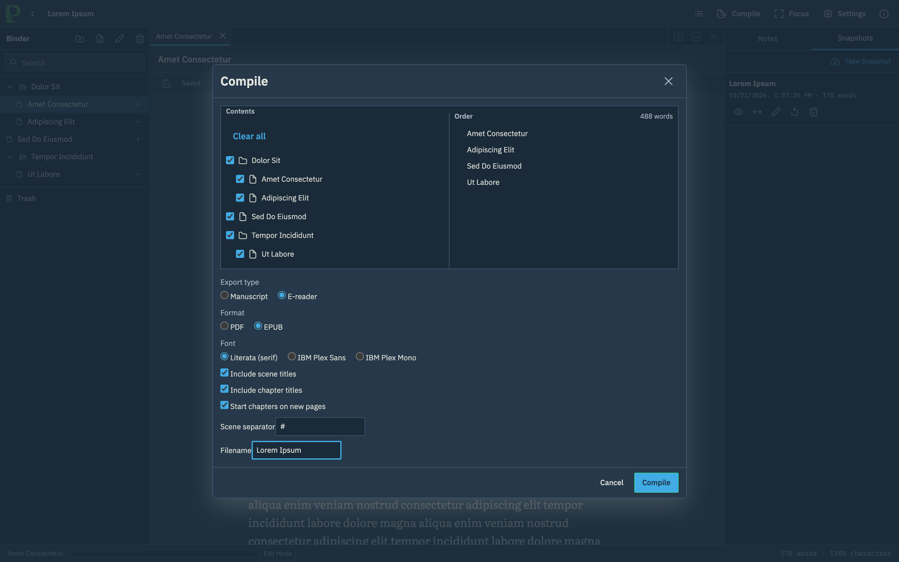

<p align="center">
  
</p>

<p align="center">
  <a href="https://github.com/brandongandy/plumavance/tags"></a>
  <a href="https://github.com/brandongandy/plumavance/commits/master"></a>
  <a href="https://github.com/brandongandy/plumavance/actions/workflows/publish-container.yml"></a>
</p>

# Plumavance

Plumavance is a private, self-hosted writing workspace inspired by Scrivener.

Features include:

- Multiple projects
- A project binder with chapters/documents
- Private document notes, and snapshots to version documents
- PDF, RTF, Markdown, and epub export
- A fullscreen typewriter mode

Plumavance is currently in **early beta**. While breaking changes are not anticipated, frequent backups are recommended.

# Screenshots

Manage writing projects from the project library.

<p align="center">
   
</p>

Organize chapters and scenes in the binder, write in the editor, and keep private notes in the inspector.

<p align="center">
   
</p>

Focus mode stays centered on the active line.

<p align="center">
   
</p>

Open two scenes side by side while revising or working from reference material.

<p align="center">
   
</p>

Compare a snapshot with the current draft before restoring an earlier version.

<p align="center">
   
</p>

Choose the binder contents and output settings for manuscript and e-reader exports.

<p align="center">
   
</p>

# Setup and Development

## Setup with Docker

1. Install Docker Engine or Docker Desktop with Docker Compose support.

2. Open a terminal in the Plumavance repository.

3. Build and start the application.

   ```sh
   docker compose up --build -d --wait
   ```

4. Open Plumavance in your browser.

   ```text
   http://localhost:3000
   ```

5. When you want to stop the application, run:

   ```sh
   docker compose down
   ```

Your projects are stored in the Docker volume named `pluma_pluma-data`. Running `docker compose down` does not delete this volume. Do not run `docker compose down --volumes` unless you intend to delete the stored application data.

To use a different host port, set `PLUMA_PORT` when starting the application:

```sh
PLUMA_PORT=8080 docker compose up --build -d --wait
```

Then open `http://localhost:8080`.

Plumavance has no accounts, login screen, or authentication.

## Back up your data

1. Keep Plumavance running.

2. Run the backup script with the desired output filename.

   ```sh
   ./scripts/backup.sh ./pluma-backup.sqlite
   ```

3. Store the resulting SQLite file somewhere separate from the Docker host.

To restore a backup, stop Plumavance, replace `/data/pluma.sqlite` in the `pluma_pluma-data` volume with the backup, ensure the file is owned by the container's `pluma` user, and start the application again. Keep the previous database until the restored application passes `/api/health` and the expected projects open correctly.

## Local development

Local development requires Node.js 24 and npm.

1. Install the locked dependencies.

   ```sh
   npm ci
   ```

2. Run linting.

   ```sh
   npm run lint
   ```

3. Run type checks.

   ```sh
   npm run typecheck
   ```

4. Run the unit tests.

   ```sh
   npm test
   ```

5. Build the application.

   ```sh
   npm run build
   ```

6. Run the browser tests.

   ```sh
   npm run test:e2e
   ```

The API reads `HOST`, `PORT`, `DATA_DIR`, and `STATIC_ROOT` from the environment. The normal browser suite uses a temporary local database and skips Docker-only checks.

On a Docker-capable host, run the container replacement, persistence, and real export-converter test with:

```sh
RUN_CONTAINER_E2E=1 npm run test:e2e -- e2e/container-persistence.spec.ts
```
